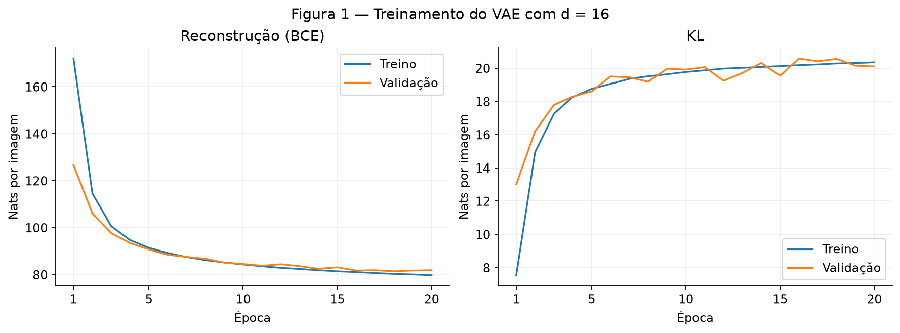
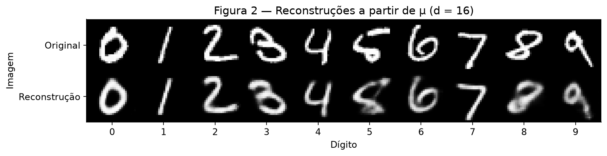
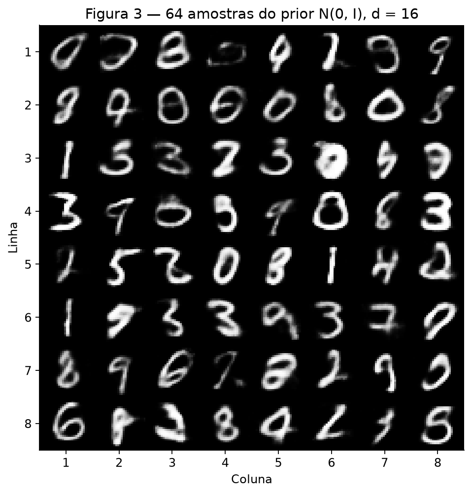
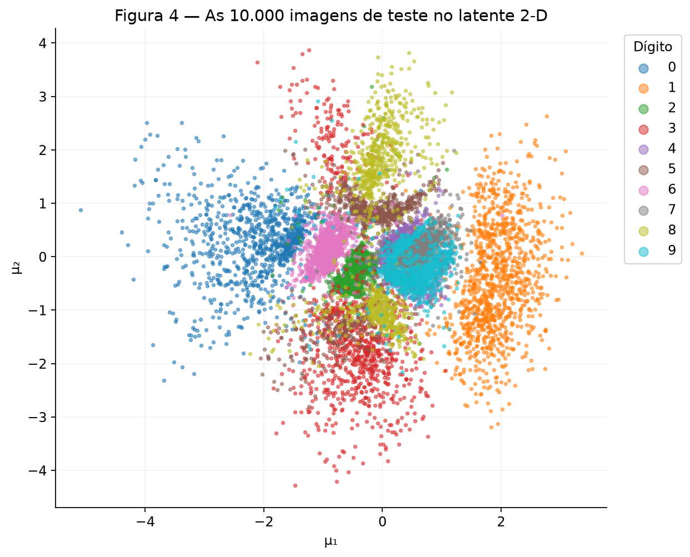
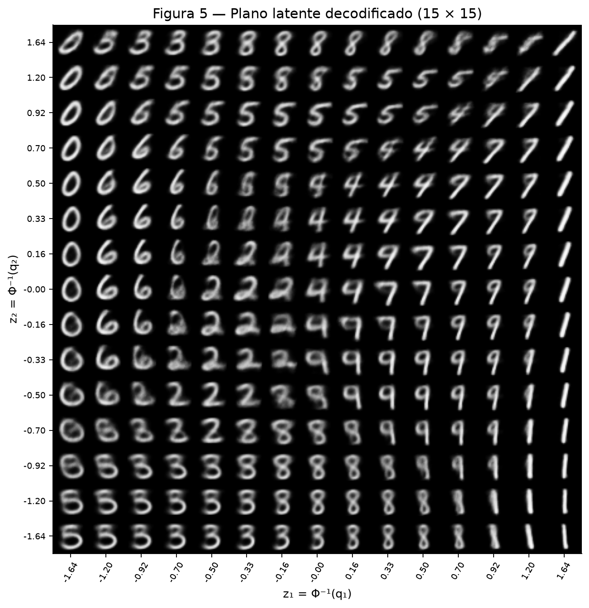
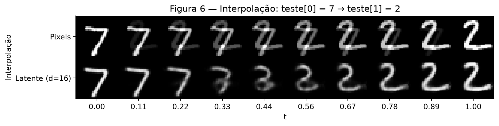

# VAE no MNIST

O objetivo foi observar a troca entre reconstruir bem uma imagem e organizar
o espaço latente perto de uma normal padrão. Para isso, treinei dois VAEs:
um com dimensão latente 16 e outro com dimensão 2.

**Código e resultados:** [script completo](code/vae.py),
[métricas da execução](resultados/metricas.json),
[histórico d = 16](resultados/historico_d16.csv) e
[histórico d = 2](resultados/historico_d2.csv).
O texto numérico é preenchido por [gerar_relatorio.py](code/gerar_relatorio.py).

Para reproduzir, na raiz do repositório, instale `requirements.txt` e execute:

```bash
python docs/exercises/vae/code/vae.py
python docs/exercises/vae/code/gerar_relatorio.py
mkdocs build
```

Ambiente usado: python 3.13.4, torch 2.15.0, torchvision 0.29.2, numpy 2.5.4, matplotlib 3.11.2, scipy 1.18.1. Os dois modelos rodaram em CPU com 4 threads,
operações determinísticas e semente 42. Os resultados abaixo são os obtidos
nesta execução, sem ajustar o treino para aproximar os valores de referência.
Uma segunda execução completa reproduziu exatamente as métricas de todas
as épocas e os arquivos das seis figuras neste ambiente.

O relatório segue o [enunciado da atividade](https://insper.github.io/ann-dl/pt/2026.2/exercises/vae/)
e o [formato de entrega da disciplina](https://insper.github.io/ann-dl/2026.2/exercises/submission/).

## Exercício 1

### A — Carregue e divida os dados

Usei o MNIST do `torchvision`: **50.000 imagens para treino, 10.000 para
validação e 10.000 para teste**. A divisão foi feita com o gerador de semente
42 exatamente como pedido. `ToTensor()` coloca os pixels em [0, 1]; dentro
do laço, cada imagem 28 × 28 vira um vetor de 784 posições.

```python
--8<-- "docs/exercises/vae/code/vae.py:dados"
```

Os rótulos não entram na perda nem são usados para treinar o VAE. Eles servem
apenas para identificar os dígitos nas figuras. O teste ficou reservado para
a avaliação final e as visualizações pedidas, após o treino dos dois modelos.

### B — Construa o modelo

O encoder tem camadas **784 → 512 → 256**, com ReLU depois de cada camada.
Duas cabeças **256 → 16** produzem μ e log σ². O decoder faz
**16 → 256 → 512 → 784**, com ReLU nas camadas ocultas e sigmoide na saída.

A reparametrização é `z = mu + exp(0.5 * logvar) * epsilon`, com
`epsilon` sorteado de N(0, I). Assim, o ruído é sorteado separadamente e
o autograd consegue calcular os gradientes de μ e log σ².

A perda é **BCE + KL**, com β = 1. A BCE soma os erros dos 784 pixels;
a KL soma `0.5 * (mu² + exp(logvar) - 1 - logvar)` nas dimensões latentes.
Só depois dividimos pelo número de imagens. Os dois termos ficam em
**nats por imagem**, pois usam logaritmos naturais.

```python
--8<-- "docs/exercises/vae/code/vae.py:modelo"
```

A BCE corresponde à hipótese de Bernoulli para os pixels, enquanto o erro
quadrático corresponde a uma hipótese gaussiana. Aqui usamos a BCE solicitada.
Usar `reduction="mean"` diretamente também dividiria pelos pixels e mudaria
o peso relativo da reconstrução em relação à KL.

### C — Treine

Usei **Adam, taxa 0,001, lotes de 128 e 20 épocas**, sem parada antecipada.
A semente foi reiniciada antes da construção de cada modelo. A ordem de
embaralhamento dos dados também tem gerador próprio com semente 42.
Foi utilizado o modelo da última época, conforme o orçamento fixado.

```python
--8<-- "docs/exercises/vae/code/vae.py:treino"
```

No treino, as métricas são médias ponderadas pelo tamanho de cada lote ao
longo da época. Na validação e no teste, os pesos ficam fixos e não calculamos
gradientes. Para estimar a reconstrução do ELBO, sorteamos **um z por imagem**,
com semente 42 na avaliação; a KL é calculada analiticamente. A semente da
avaliação não altera a sequência aleatória do treino. Portanto, esses números
não são a perda obtida ao decodificar somente μ.

No teste, o VAE de dimensão 16 obteve **81,24 nats de
reconstrução**, **20,15 nats de KL** e **101,40 nats de
ELBO negativo por imagem**.



**Figura 1.** Os termos são mostrados separadamente. A KL de validação foi
**13,01** na primeira época e **20,10** na
última, em nats por imagem. A curva de treino inclui pesos que mudam durante
a época, enquanto a validação usa os pesos do fim da época.

### D — Reconstruções e amostras

Na Figura 2, usei a primeira imagem de cada dígito no teste. Os índices,
na ordem dos dígitos de 0 a 9, são **3, 2, 1, 18, 4, 8, 11, 0, 61, 7** (contagem a partir de zero).
A linha inferior é `decoder(mu)`, sem ruído na reconstrução.



**Figura 2.** Originais em cima e reconstruções a partir de μ embaixo.

Na Figura 3, executei `torch.manual_seed(0)`, sorteei
`z = torch.randn(64, 16)` e decodifiquei esses vetores. São imagens novas,
sem passar uma imagem de entrada pelo encoder. Exibimos as probabilidades
produzidas pela sigmoide em tons de cinza.



**Figura 3.** Amostras geradas pelo VAE de dimensão 16.

### E — Análise

**1. Por que pagar mais KL?** Nas duas primeiras épocas, a KL de validação
passou de **13,01 para 16,21**, enquanto a
reconstrução caiu de **126,64 para 106,08**.
A soma caiu de **139,65 para
122,28 nats por imagem**. O modelo aceita
afastar as distribuições codificadas do prior porque isso permite guardar
informações úteis sobre cada imagem. A redução na reconstrução compensa o
aumento na KL. Minimizar só a KL faria todas as imagens receberem a mesma
distribuição N(0, I), sem informação para distingui-las.

**2. Por que as amostras podem parecer piores?** Há duas razões diferentes:

- **Onde o z cai:** o prior e a distribuição agregada dos códigos não coincidem
  perfeitamente. Um sorteio de N(0, I) pode cair em regiões pouco visitadas
  durante o treino. Já a reconstrução começa no código de uma imagem real.
- **O que sai do decoder:** a sigmoide representa a probabilidade de cada
  pixel estar aceso. Quando um código é compatível com traços diferentes,
  a BCE favorece probabilidades intermediárias nesses pixels. Mostrar essas
  probabilidades produz traços cinzentos e borrados, mesmo em uma região
  conhecida. Não estamos sorteando os pixels de uma Bernoulli.

Essa segunda explicação é a versão para BCE da discussão de média condicional
na [seção da aula sobre o borrão](https://insper.github.io/ann-dl/pt/2026.2/classes/variational-autoencoders/#por-que-as-amostras-sao-borradas-e-por-que-isso-nao-importa).

**3. Por que decodificar μ?** Isso fornece uma reconstrução determinística
para cada entrada e facilita comparar as duas linhas. Sortear z acrescentaria
uma variação que poderia mudar a imagem a cada tentativa. μ é a média da
posterior, mas `decoder(mu)` não é necessariamente a média de todas as
imagens decodificadas, pois o decoder é não linear.

## Exercício 2

### A — Treine um VAE 2-D

Repeti o treino mudando apenas a dimensão latente para **d = 2**. Mantive
a divisão dos dados, semente 42, arquitetura das camadas ocultas, β = 1,
Adam com taxa 0,001, lotes de 128 e 20 épocas.

| Dimensão latente | Reconstrução no teste | KL no teste | ELBO negativo no teste |
| --- | ---: | ---: | ---: |
| d = 16 | 81,24 | 20,15 | 101,40 |
| d = 2 | 135,93 | 6,54 | 142,47 |

Todos os valores estão em **nats por imagem**. Com duas dimensões,
a reconstrução ficou **54,69 nats pior**, aumento de
**67,31%**. A KL menor não significa que esse modelo seja melhor:
ele paga menos regularização, mas perde muito mais na reconstrução.

### B — O conjunto de teste codificado

A Figura 4 mostra μ para **todas as 10.000 imagens de teste**. Cada cor
identifica uma classe. O modelo não recebeu esses rótulos durante o treino.



**Figura 4.** As classes formam regiões, mas não ficam completamente separadas.

### C — O plano decodificado

Usei `q = np.linspace(0.05, 0.95, 15)` e `norm.ppf(q)` em cada eixo,
formando 225 pontos. As coordenadas vão de aproximadamente **−1,645 a
1,645**. Na figura, z₁ cresce para a direita e z₂ cresce para cima.



**Figura 5.** Os intervalos entre quantis consecutivos têm a mesma probabilidade
em cada eixo e, pela independência de z₁ e z₂ no prior, os retângulos entre
eles têm a mesma massa de probabilidade.

Isso se refere às células delimitadas pelos pontos: as 225 imagens são
avaliações nos pontos da grade, e as caudas além de 0,05 e 0,95 ficam de fora.
Os pontos ficam mais próximos no centro, onde a normal é mais densa.

### D — Interpolação

Escolhi os índices de teste **0 (dígito 7)** e **1 (dígito 2)**, contando
a partir de zero. São as duas primeiras imagens, sem escolha por aparência.
Usei 10 valores igualmente espaçados de t entre 0 e 1.

Na linha de cima, calculei `(1 - t) * xa + t * xb`. Na linha de baixo,
usei o **VAE d = 16** e calculei `decoder((1 - t) * mu_a + t * mu_b)`.
Os extremos da segunda linha são reconstruções, e não os pixels originais.



**Figura 6.** Comparação dos dois caminhos entre o 7 e o 2.

### E — Análise

**1. Onde os dígitos se sobrepõem?** Na Figura 4, os dígitos **4, 7 e 9**
se misturam à direita do centro, aproximadamente em μ₁ entre **0,1 e 1,2**
e μ₂ entre **−0,6 e 0,6**. A Figura 5 mostra uma transição correspondente:
na coluna **z₁ ≈ 0,50**, há uma forma de **4 em z₂ ≈ 0,50**, de **7 em
z₂ ≈ 0** e de **9 em z₂ ≈ −0,33**. Entre elas, os traços horizontais mudam
de intensidade e o laço superior se abre ou se fecha. Algumas imagens são
ambíguas, sem uma fronteira nítida entre as classes. A comparação é visual;
não foi usado um classificador para atribuir rótulos às imagens geradas.

**2. Qual é o custo de usar só dois números?** Com a regularização e a
capacidade fixadas, o modelo precisa comprimir identidade do dígito,
inclinação, espessura e estilo da escrita em poucas coordenadas. Parte dos
detalhes individuais se perde e imagens diferentes acabam com códigos
próximos. A Figura 5 mostra formas intermediárias e traços suavizados
nas transições, em vez de preservar todas as variações de escrita.
Isso acompanha o aumento de **81,24 para
135,93 nats** na reconstrução do teste.

**3. Qual interpolação passa por dígitos?** Na linha dos pixels, os traços
do 7 vão desaparecendo enquanto os do 2 aparecem por cima: perto do meio,
vemos uma sobreposição translúcida das duas imagens. A combinação linear
de pixels não sabe como um dígito é desenhado. Na linha latente, o decoder
transforma os códigos intermediários em formas aprendidas no treino;
por isso a mudança tende a manter traços mais coerentes. Isso não garante
que todos os pontos sejam um dígito inequívoco: podem existir formas ambíguas
durante a transformação. Nesta execução, perto de **t = 0,44 e 0,56**,
a linha latente também fica borrada, mas a base do 2 aparece gradualmente,
em vez de simplesmente ser sobreposta ao 7 original.

## Resumo dos resultados

| # | Quantidade | Valor |
| --- | --- | --- |
| 1 | Ex. 1 — reconstrução, KL e ELBO negativo no teste (d = 16) | **81,24; 20,15; 101,40 nats/imagem** |
| 2 | Ex. 1 — KL de validação na primeira e na última época | **13,01; 20,10 nats/imagem** |
| 3 | Ex. 2 — reconstrução e KL no teste (d = 2) | **135,93; 6,54 nats/imagem** |
| 4 | Ex. 2 — os dois índices de teste interpolados | **0 (dígito 7) e 1 (dígito 2)** |
